<a href="https://boopathi-376.web.app">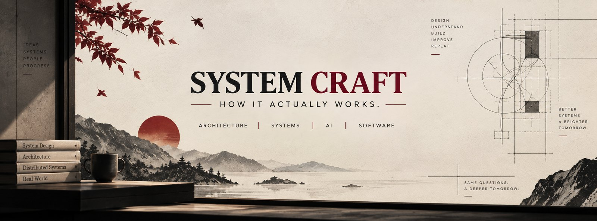</a>

<p align="center">
  <a href="https://boopathi-376.web.app"></a>
</p>

<p align="center">
  <a href="https://boopathi-376.web.app"></a>
  <a href="https://www.linkedin.com/in/boopathisennappan/"></a>
  <a href="https://huggingface.co/Boopathi376"></a>
  <a href="mailto:boopathi5140@gmail.com"></a>
  <a href="https://boopathi-376.web.app/resume.pdf"></a>
</p>

<p align="center">
  
  <a href="https://github.com/boopathi-376?tab=followers"></a>
  
</p>

<picture><source media="(prefers-color-scheme: dark)" srcset="./assets/intro-dark.svg" /></picture>

<picture><source media="(prefers-color-scheme: dark)" srcset="./assets/stats-dark.svg" /></picture>

<br /><br />

<picture><source media="(prefers-color-scheme: dark)" srcset="./assets/sec-about-dark.svg" /></picture>

```python
class Boopathi:
    role       = "Software Developer Intern @ Levarus"
    working_on = ["Core banking — Oracle FLEXCUBE", "AI agents for banking workflows"]
    builds     = ["AI agents", "retrieval pipelines", "FastAPI backends", "Flutter apps"]
    approach   = "Explore → Compare → Decide → Build"   # architecture before code
    education  = "B.Tech AI & Data Science, MCET Pollachi (2023–2027)"
    won        = "Smart India Hackathon 2025 — Smart Education 🏆"
    contributed_to = ["google/adk-python", "mycelium-labs/mycelium"]

    def motto(self):
        return "Same questions. A deeper tomorrow."
```

<br />

<picture><source media="(prefers-color-scheme: dark)" srcset="./assets/sec-oss-dark.svg" /></picture>

<p><a href="https://github.com/google/adk-python/commit/a6c6623455e6064f1934bdff260abdc3f6eb5025"><picture><source media="(prefers-color-scheme: dark)" srcset="./assets/oss-adk-dark.svg" /></picture></a> <a href="https://github.com/mycelium-labs/mycelium/pull/155"><picture><source media="(prefers-color-scheme: dark)" srcset="./assets/oss-mycelium-dark.svg" /></picture></a></p>

<br />

<picture><source media="(prefers-color-scheme: dark)" srcset="./assets/sec-work-dark.svg" /></picture>

<p><a href="https://github.com/boopathi-376/Legal-AI-Chatbot"><picture><source media="(prefers-color-scheme: dark)" srcset="./assets/legal-ai-dark.svg" /></picture></a> <a href="https://github.com/boopathi-376/Meta-LambdaLads"><picture><source media="(prefers-color-scheme: dark)" srcset="./assets/lambdalads-dark.svg" /></picture></a></p>
<p><a href="https://github.com/boopathi-376/Semantic-Filter-Driven-Chatbot"><picture><source media="(prefers-color-scheme: dark)" srcset="./assets/semantic-dark.svg" /></picture></a> <a href="https://boopathi-376.web.app"><picture><source media="(prefers-color-scheme: dark)" srcset="./assets/cpsam-dark.svg" /></picture></a></p>

<br />

<picture><source media="(prefers-color-scheme: dark)" srcset="./assets/sec-journey-dark.svg" /></picture>

<picture><source media="(prefers-color-scheme: dark)" srcset="./assets/journey-dark.svg" /></picture>

<br /><br />

<picture><source media="(prefers-color-scheme: dark)" srcset="./assets/sec-thinking-dark.svg" /></picture>

<picture><source media="(prefers-color-scheme: dark)" srcset="./assets/process-dark.svg" /></picture>

<br /><br />

<picture><source media="(prefers-color-scheme: dark)" srcset="./assets/sec-stack-dark.svg" /></picture>

<p align="center">
  <a href="https://skillicons.dev"></a>
</p>

<p align="center">
  
  
  
  
  
  
  
</p>

<br />

<picture><source media="(prefers-color-scheme: dark)" srcset="./assets/sec-activity-dark.svg" /></picture>

<p align="center"><picture><source media="(prefers-color-scheme: dark)" srcset="./profile/stats-dark.svg" /></picture> <picture><source media="(prefers-color-scheme: dark)" srcset="./profile/langs-dark.svg" /></picture></p>

<p align="center"><picture><source media="(prefers-color-scheme: dark)" srcset="https://streak-stats.demolab.com?user=boopathi-376&hide_border=true&background=161B22&ring=E5535F&fire=E5535F&currStreakNum=F0F3F6&currStreakLabel=E5535F&sideNums=F0F3F6&sideLabels=8B949E&dates=8B949E&stroke=30363D" /></picture></p>

<picture><source media="(prefers-color-scheme: dark)" srcset="./profile-3d-contrib/profile-night-green.svg" />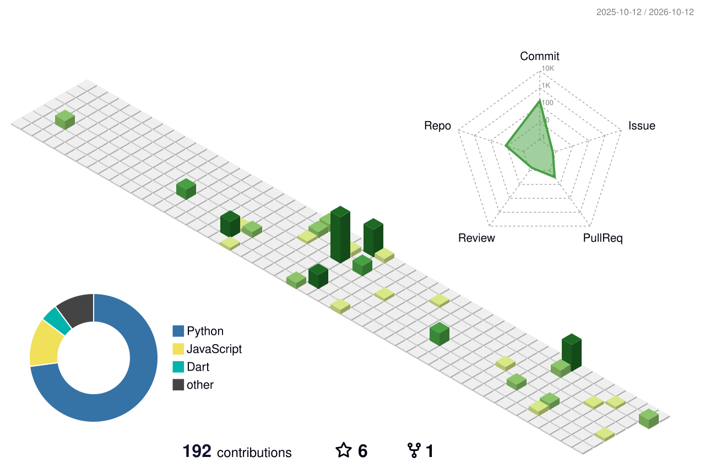</picture>

<picture><source media="(prefers-color-scheme: dark)" srcset="https://raw.githubusercontent.com/boopathi-376/boopathi-376/output/github-snake-dark.svg" /></picture>

<br />

<p align="center">
  <i>Want to talk about system design, AI architecture or a project? <a href="mailto:boopathi5140@gmail.com">Write to me</a>. I reply to every email.</i>
</p>


